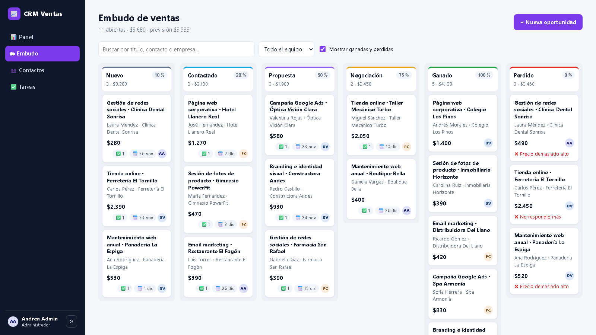
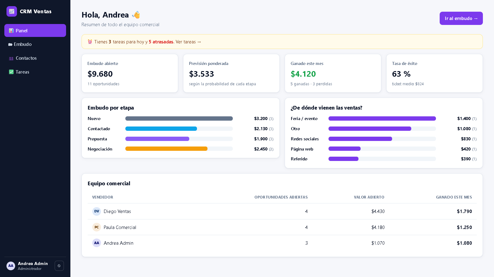
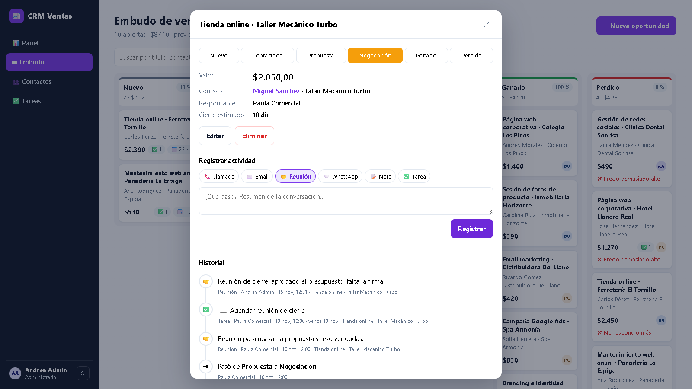
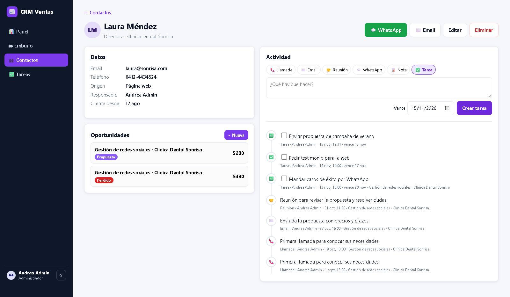
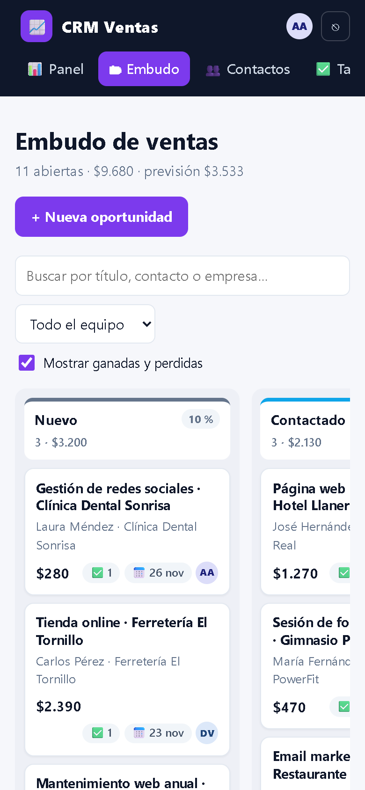

# 📈 CRM de Ventas para Pymes

[](https://github.com/frankbuitrago3-code/crm-pymes/actions/workflows/ci.yml)


CRM para que el equipo comercial de una pequeña empresa organice sus **clientes**, siga cada **oportunidad de venta** en un tablero Kanban y no olvide ningún **seguimiento**.

El ejemplo incluido es una agencia de marketing digital con tres comerciales y dieciséis clientes.



## El problema que resuelve

En muchas pymes la información de los clientes está repartida entre el WhatsApp de cada vendedor, hojas de cálculo y la memoria de cada uno. Eso trae varios problemas:

- se olvidan llamadas de seguimiento;
- no se sabe cuánto dinero hay "en juego";
- si un comercial se va, se lleva el historial.

Este CRM centraliza todo eso:

- **Embudo visual:** cada oportunidad es una tarjeta que se **arrastra** de etapa en etapa, de *Nuevo* a *Ganado*.
- **Previsión de ventas:** el valor de cada etapa se pondera por su probabilidad de cierre.
- **Tareas con fecha:** las tareas atrasadas y las de hoy aparecen nada más entrar.
- **Historial completo** de cada cliente: llamadas, emails, reuniones, WhatsApp, notas y cambios de etapa.
- **Por qué se pierden las ventas:** al perder una oportunidad es obligatorio indicar el motivo.

## Funcionalidades

| Módulo | Qué hace |
|---|---|
| **Panel** | Valor del embudo abierto, previsión ponderada, ganado en el mes, tasa de éxito y ticket medio. Gráficos por etapa y por origen del cliente («¿de dónde vienen las ventas?»). Para el administrador, ranking del equipo comercial. |
| **Embudo** | Tablero Kanban con 6 etapas, **arrastrar y soltar** (también para reordenar dentro de una columna), totales por columna, búsqueda y filtro por vendedor. |
| **Oportunidad** | Ficha con cambio rápido de etapa, edición, registro de actividades e **historial** de actividades y cambios de etapa. |
| **Contactos** | Búsqueda, filtro por origen, paginación, oportunidades abiertas, valor ganado y última actividad de cada contacto. La ficha tiene botones de **WhatsApp** y **email**. |
| **Tareas** | Agrupadas en *atrasadas*, *para hoy* y *próximas*; se completan con un clic. |
| **Roles** | El **administrador** ve a todo el equipo y puede reasignar. Cada **vendedor** solo ve y modifica sus oportunidades y tareas. |

<table>
  <tr>
    <td></td>
    <td></td>
  </tr>
  <tr>
    <td></td>
    <td align="center"></td>
  </tr>
</table>

## Decisiones técnicas

- **Orden fraccionario para el Kanban.** Cada tarjeta guarda una `posicion` decimal. Al soltarla entre otras dos, recibe el punto medio ([`posicionEntre`](shared/crm.ts)), así que mover una tarjeta **actualiza una sola fila** y no toda la columna. El servidor recalcula la posición dentro de una transacción.
- **Actualización optimista.** La tarjeta se mueve en pantalla al instante y la petición se envía en segundo plano. Si el servidor la rechaza (sin permiso o sin motivo de pérdida), **el movimiento se deshace** y se muestra el error.
- **Permisos aplicados en el servidor**, no solo ocultando botones:
  - un vendedor no puede ver, mover ni borrar oportunidades ajenas;
  - un vendedor no puede asignarse trabajo a nombre de otro;
  - un vendedor no puede completar tareas de un compañero.

  Hay pruebas que verifican cada caso.
- **Historial de etapas** (`eventos_etapa`): cada cambio queda registrado con quién y cuándo. Ganar o perder fija la fecha de cierre, y reabrir una oportunidad la borra.
- **Validación con Zod** en todas las entradas de la API, con mensajes en español que la interfaz muestra tal cual.
- **Código compartido** entre el servidor y el navegador ([`shared/crm.ts`](shared/crm.ts)): etapas, probabilidades, formatos y cálculos se definen una sola vez.
- **Seguridad:**
  - Contraseñas con **scrypt** y sal aleatoria.
  - Sesión en cookie **JWT `HttpOnly` y `SameSite`**.
  - Límite de intentos de inicio de sesión.
  - **Protección CSRF:** toda petición que modifica datos debe llevar una cabecera propia (`X-CRM`), que un formulario de otra web no puede enviar.
  - Consultas SQL parametrizadas y cabeceras de seguridad.
- **Accesible y usable en el móvil.** Las tarjetas se abren con el teclado y la etapa también se cambia con botones, que es la alternativa al arrastre en pantallas táctiles. En el móvil, el tablero se desplaza en horizontal columna a columna.
- **Un solo servidor en producción:** Express sirve la API y la aplicación React ya compilada.

## Tecnologías

**Frontend:** React 19 · React Router 7 · TypeScript · Vite · CSS propio (sin frameworks ni librerías de arrastrar y soltar)  
**Backend:** Node.js · Express 5 · Zod · SQLite (`better-sqlite3`) · `jose` (JWT)  
**Calidad:** Vitest + Supertest (22 pruebas de API y lógica) · GitHub Actions (pruebas, comprobación de tipos y build)

## Estructura

```
crm-pymes/
├── shared/crm.ts          # Etapas, probabilidades, formatos y cálculos (servidor + navegador)
├── server/
│   ├── app.ts             # Rutas de la API, errores y servidor de la web
│   ├── crm.ts             # Reglas de negocio y permisos
│   ├── auth.ts            # Contraseñas, sesión JWT, CSRF y límite de intentos
│   ├── db.ts              # Esquema SQLite
│   └── demo.ts            # Datos de demostración
├── src/                   # Aplicación React
│   ├── paginas/           # Panel, Embudo, Oportunidad, Contactos, Tareas
│   ├── componentes.tsx    # Modal, línea de tiempo, formulario de actividad…
│   └── api.ts · sesion.tsx
└── tests/                 # Pruebas de la API (Supertest) y de la lógica compartida
```

## Cómo ejecutarlo

Requisitos: **Node.js 22 o superior**.

```bash
git clone https://github.com/frankbuitrago3-code/crm-pymes.git
cd crm-pymes
npm install
npm run dev
```

Abre <http://localhost:5173>. La primera vez se cargan datos de demostración. Puedes entrar con:

| Email | Contraseña | Rol |
|---|---|---|
| `admin@crm.test` | `admin123` | Administrador (ve a todo el equipo) |
| `vendedor@crm.test` | `vendedor123` | Vendedor (solo ve lo suyo) |

`npm run demo` reinicia la base de datos con los datos de ejemplo.

### Pruebas

```bash
npm test
```

Las pruebas cubren:

- la autenticación, el bloqueo por intentos, la cookie segura y la protección CSRF;
- la validación de los datos;
- los permisos entre vendedores y administrador;
- el arrastre de tarjetas (cambio de etapa, orden e historial);
- el motivo obligatorio al perder una oportunidad;
- las tareas y los indicadores del panel.

### Producción

```bash
npm ci
npm run build
NODE_ENV=production SESSION_SECRET="una-clave-larga" npm start
```

La aplicación queda en el puerto 3200 (configurable con `PORT`). Necesita un servidor con disco persistente para el archivo SQLite, por ejemplo un VPS, Railway o Fly.io.

## Próximas mejoras

- Importar contactos desde Excel o CSV.
- Recordatorios de tareas por email.
- Productos y presupuestos vinculados a cada oportunidad.
- Informe mensual de ventas por vendedor en PDF.

## Licencia

[MIT](LICENSE) © smartbyte
